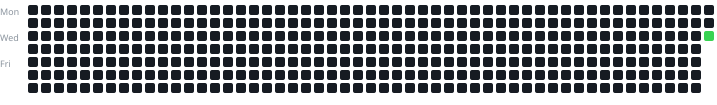

cat > README.md <<'EOF'
# 💻 DSA Practice | Consistency Tracker

Documenting my journey of consistently practicing Data Structures and Algorithms across multiple coding platforms.

### 🌐 Coding Platforms

- [AtCoder](https://atcoder.jp/) – Competitive Programming
- [NxtWave](https://www.ccbp.in/) – DSA Practice

### 🔥 My DSA Consistency

Tracking my coding activity specifically in this repository.



*Updated automatically using GitHub Actions.*

### 📁 Repository Structure

```text
Coding_solutions/
├── atcoder/
├── nxtwave/
├── assets/
├── scripts/
└── README.md