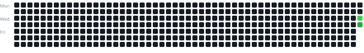

# Coding Solutions | DSA Practice

A central repository for organizing my Data Structures and Algorithms solutions across multiple coding platforms.

I use this repository to keep my practice history organized, track consistency, and make it easy to find solutions by platform.

## Coding Platform Profiles

| Platform | Username / Profile | Solutions |
|---|---|---|
| AtCoder | [janakiram218](https://atcoder.jp/users/janakiram218) | [View solutions](./solutions/AtCoder/) |
| Codeforces | [Ram-](https://codeforces.com/profile/Ram-) | [View solutions](./solutions/Codeforces/) |
| LeetCode | [Janakiram1700](https://leetcode.com/u/Janakiram1700/) | [View solutions](./solutions/LeetCode/) |
| CodeChef | [CodeChef](https://www.codechef.com/) | [View solutions](./solutions/CodeChef/) |
| NxtWave | [NxtWave](https://www.ccbp.in/) | [View solutions](./solutions/NxtWave/) |
| HackerRank | [HackerRank](https://www.hackerrank.com/) | [View solutions](./solutions/HackerRank/) |
| GeeksforGeeks | [GeeksforGeeks](https://www.geeksforgeeks.org/) | [View solutions](./solutions/GeeksforGeeks/) |

## Repository Structure

All coding solutions are stored inside the `solutions/` directory. Each platform has its own folder, so solutions remain separate and easy to browse.

```text
Coding_solutions/
├── README.md
├── solutions/
│   ├── AtCoder/
│   │   └── contest/
│   │       └── problem.cpp
│   ├── Codeforces/
│   ├── LeetCode/
│   ├── CodeChef/
│   ├── NxtWave/
│   ├── HackerRank/
│   ├── GeeksforGeeks/
│   └── _tracker/
│       ├── assets/
│       │   └── heatmap.svg
│       ├── collectors/
│       ├── config/
│       │   └── platforms.json
│       ├── data/
│       └── scripts/
│           └── generate_heatmap.py
└── .github/
    └── workflows/
        └── heatmap.yml
```

### Where should new solutions go?

Save every solution in the folder for the platform where you solved the problem.

Examples:

- AtCoder: `solutions/AtCoder/<contest>/<problem>.cpp`
- Codeforces: `solutions/Codeforces/<contest>/<problem>.cpp`
- LeetCode: `solutions/LeetCode/<problem-name>.<extension>`
- CodeChef: `solutions/CodeChef/<contest-or-topic>/<problem>.<extension>`
- NxtWave: `solutions/NxtWave/<topic>/<file>.<extension>`
- HackerRank: `solutions/HackerRank/<domain>/<problem>.<extension>`
- GeeksforGeeks: `solutions/GeeksforGeeks/<topic>/<problem>.<extension>`

Use descriptive filenames and, where useful, group contest problems or topic-based exercises into subfolders.

## DSA Consistency Heatmap

The heatmap is generated by the repository's GitHub Actions workflow.



The tracker implementation and its configuration are kept in `solutions/_tracker/`, separate from platform solution folders. The workflow definition stays in `.github/workflows/` because GitHub Actions requires workflows to be stored there.

## Automation

- Workflow: [Update DSA Consistency Heatmap](./.github/workflows/heatmap.yml)
- Tracker configuration: [platforms.json](./solutions/_tracker/config/platforms.json)
- Heatmap generator: [generate_heatmap.py](./solutions/_tracker/scripts/generate_heatmap.py)

## Goal

Practice consistently, improve problem-solving skills, and maintain a clean, searchable record of solutions across coding platforms.

**Consistency over intensity. One problem at a time.**
